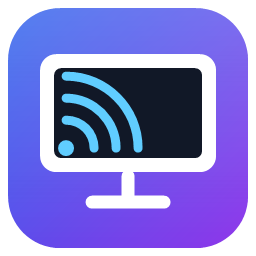

<p align="center"></p>

# Compartir Pantalla en TV

App para Windows que transmite cualquiera de tus pantallas, **con imagen y sonido sincronizados**, a una Smart TV con Google Cast (Chromecast integrado) por la red local. Basta con pulsar **Iniciar transmisión** en el PC: la TV abre la transmisión sola, sin tocar el mando ni escribir direcciones.

## Descarga

Descarga `CompartirPantalla.exe` desde la sección [Releases](../../releases). Es un único archivo: no requiere instalación.

## Uso

1. El PC y la TV deben estar en la misma red (WiFi o cable).
2. Abre la app; busca las TVs automáticamente.
3. Elige la TV y la pantalla, y pulsa **Iniciar transmisión**. La imagen aparece en la TV en unos segundos.
4. **Detener transmisión** devuelve la TV a su pantalla de inicio.

Si Windows pregunta por el firewall, permite el acceso en redes privadas.

## Características

- Vídeo **H.264** (hasta 1440p, 24/30/60 fps) con audio **AAC** en un solo stream: imagen y sonido siempre sincronizados.
- Captura por GPU (**DXGI Desktop Duplication**), con GDI como respaldo automático.
- Usa los codificadores de **Media Foundation** incluidos en Windows: no necesita FFmpeg ni otras dependencias.
- Captura el **audio del sistema** (WASAPI loopback).
- **Colchón adaptativo** en la TV: empieza con poco retraso (~0,4 s) y lo ajusta solo según la estabilidad del WiFi.
- Descubre las TVs por SSDP y por el puerto de Google Cast, aunque cambien de IP.
- Modo de respaldo (JPEG + audio PCM) para navegadores sin Media Source Extensions: también se puede abrir la dirección que muestra la app en cualquier navegador de la red.

## Limitaciones

- Retraso de ~0,6–0,8 s: ideal para vídeo y presentaciones, no para juegos o uso del ratón en tiempo real.
- Solo TVs con Google Cast. La TV abre la transmisión con el receptor público *DashCast*, así que necesita conexión a internet.

## Cómo funciona

1. La app captura el monitor y el audio del sistema con un reloj común.
2. Los codifica en H.264 y AAC y los empaqueta en MP4 fragmentado.
3. Un servidor HTTP integrado (puerto 8080) sirve el stream y la página del reproductor.
4. Por el protocolo Google Cast (CASTV2), la app ordena a la TV abrir esa página, que reproduce el stream con Media Source Extensions.

| Archivo | Contenido |
|---|---|
| `Program.cs` | Interfaz, servidor HTTP, captura de audio, conexión Google Cast y descubrimiento de TVs |
| `Live.cs` | Codificadores H.264/AAC (Media Foundation), MP4 fragmentado y sesión de transmisión |
| `Dxgi.cs` | Captura de pantalla con DXGI Desktop Duplication |
| `make-icon.ps1` | Genera `icon.ico` |

## Compilar

Solo necesitas Windows 10/11; usa el compilador de C# incluido en .NET Framework 4:

```
build.cmd
```

Para regenerar el icono:

```
powershell -ExecutionPolicy Bypass -File make-icon.ps1
```
